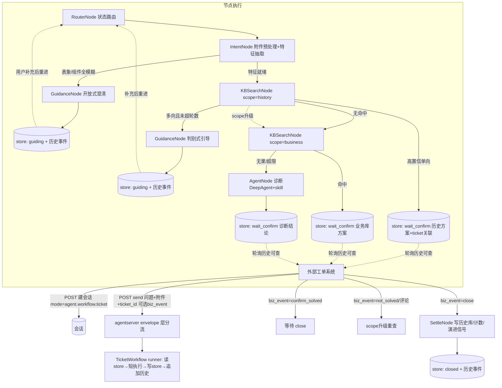

# 工单问题诊断闭环（TicketWorkflow）设计文档

- 日期：2026-11-26（实例隔离修订版）
- 状态：待评审
- 演进史：2010f2e15 → 3cc09cc96 → daad3edca → 06a13a592 → b49fa96db → 本轮（双实例隔离讨论拍板）

---

## 1. 需求功能澄清

### 1.1 需求描述

用户提出产品问题（问题描述 + 可选图片/日志附件），按三级链路处理：

1. **第一级·历史知识库**：优先判断问题是否已存在于历史知识库；存在且有解决方案 → 直接返回结果 + 历史问题关联信息（ticket_id 回关联工单系统）。
2. **第二级·业务知识库**：历史库未命中或用户反馈未解决 → 业务知识库查询，处理同第一级；但用户确认解决后**只写历史库，业务库不动**。
3. **第三级·Agent 处理**：两级均未成功 → 诊断 Agent（挂专门的问题定位 skill，用户侧预置），触发 skill 结合问题描述与附件日志分析给出结论；用户确认关闭后触发 skill 演进（auto_save 自动落盘，无需确认）。

### 1.2 附加要求

- **越用越准**：历史知识库随闭环沉淀（判重合并计数 + 长尾合并收敛类别）；skill 经 SkillEvolutionRail 自演进。
- **渐进式引导**：新问题召回多个不同方向时，不急于给答案，生成判别式澄清选项引导补充；选项文案来自历史根因分布与区分性特征（历史经验的沉淀形态，非预先配置的目录）。
- **双触发模式**：模式一 HTTP（外部工单系统，本 spec 范围）；模式二聊天问答式（workflow 挂到聊天 agent，第二阶段，契约预留）。两模式为**两个独立 workflow 实例**，见 §2.2。

### 1.3 边界与拍板记录

| 决策点 | 结论 |
|---|---|
| 实现位置 | 本仓（uapclaw-gateway）内，复用既有 KB/agent/skill/HITL 设施 |
| 多租户 | 不做，单用户 |
| 工单实体 | 外部工单系统持有，仅 HTTP 调用触发；两侧靠 `ticket_id` 关联 |
| 编排形态 | workflow（PregelGraph）；等待外部输入 = END + 持久化状态 + 重进路由，不用图内 interrupt |
| 执行模型 | **永 END 铁律**：workflow 图内无挂起、无图内 interrupt，每次执行遇等待态必 END；恢复 = 重新 invoke，非断点续跑 |
| 实例模型 | **双实例共享内核**（本轮拍板）：HTTP / 聊天 = 两个独立 workflow 实例，共享节点库 + 状态转移表 + TicketInput schema；唯一共享数据面 = GraphKB；隔离条款见 §2.3 |
| 分流键 | mode 进 canonical 三段式体系：`agent.workflow.ticket`（本轮拍板，方案乙） |
| 分流层 | agentserver envelope 层（handle_message），mode 命中 `agent.workflow.*` 直接交 runner，不进门面（本轮拍板） |
| HTTP 结果通道 | **追加会话历史**（本轮拍板）：复用 AppendHistoryRecord，外部轮询既有历史接口取增量；metadata 只留会话属性，不写 workflow 结果 |
| 知识库引擎 | 历史库与业务库均为 GraphKnowledgeBase（各自独立 collection）；分类树是三元组的查询侧视图，非独立存储 |
| 初始 skill | 用户侧预置提供，本设计只负责装配与触发 |
| 业务库导入面板 | 第二阶段子项目，本 spec 仅定契约（workflow 只依赖契约） |
| 关闭终态 | 终态定义权在工单系统（confirm_solved 后他们关单下发 close）；`closed` 仅表示"已沉淀完成"的回执 |
| CI 结果 | 默认不追踪（规则 11），完成标准 = 本地编译 + vet + 单测 + 集成测试 + 推送 |

---

## 2. 架构设计

### 2.1 总体架构

```
外部工单系统 / 聊天会话
  │
  ▼
agentserver envelope 层（handle_message 分流）
  ├── chat.send 且会话 metadata mode 命中 agent.workflow.* ──▶ TicketWorkflow runner
  │     （读 store → 短执行 → 写 store → 追加历史记录 → 返回）
  ├── 其余 chat.* ──▶ 既有门面链路（ExecuteMessageStream / ProcessMessage，零改动）
  ──▶ 既有 KB / DeepAgent / SkillEvolutionRail / interrupt 组件（零改动）
```

### 2.2 双实例共享内核

**两模式是两个独立 workflow 实例，不是"一套机制对外呈现两种样子"。** 每次诊断 = 一个实例 = 一个会话 + 一份实例私有 store；HTTP 实例由工单系统建会话触发，聊天实例由 DeepAgent 工具调起，互不感知。

**同源内核（共享资产）：**

| 共享面 | 内容 |
|---|---|
| 节点库函数 | §3 六节点实现（Router/Intent/Guidance/KBSearch/Agent/Settle） |
| 状态转移表定义 | §3.3 状态路由与转移规则 |
| TicketInput schema | §4.3 同构入参 + 校验规则（"description 非空"） |
| GraphKB | 历史库 + 业务库 + SettleNode 落库函数——唯一共享数据面，跨实例知识流动只经此 |

**各自适配面（互不相同，各自成立）：**

| | HTTP 实例（本 spec 范围） | 聊天实例（第二阶段） |
|---|---|---|
| 入口 | envelope 层分流直调 runner | DeepAgent 调 `start_diagnosis`/`continue_diagnosis` 工具 |
| 等待呈现 | 追加历史记录（事件流），外部轮询历史接口 | 经 ReAct 中断信封发 ask_user 卡片（见 §2.4） |
| 输入解释 | send 中 `biz_event` 协议直读（结构化，无歧义） | 卡片结构化 answers 直读（不经 LLM 猜测） |
| 输出表达 | 追加历史记录（结构化事件载荷） | AgentNode 结论走会话 chunk → final |

### 2.3 实例隔离条款（铁律）

1. **键空间隔离**：每个诊断实例生成 `instance_id`（uuid，`start_diagnosis` 时生成；HTTP 实例 = 会话维度一实例），实例 store 全部键带前缀 `ticket:{instance_id}:*`；两实例物理上无法互写。
2. **禁止桥接**：不为"跨模式同步状态"建立任何机制（共享 store 前缀、实例间事件总线、跨会话引用）；跨实例知识流动**只经 GraphKB**（聊天实例沉淀的结论，HTTP 实例下次检索可召回）。
3. **中断呈现私有**：聊天实例的 ask_user 中断是聊天呈现层的私事；HTTP 实例与工单系统不感知、不消费。
4. **恢复归属**：ReAct 恢复输入（`WorkflowResumeInputsKey` 旁路）按 tool call 绑定的 instance_id 分发，答案只进绑定的那个实例。
5. **答案归属判定**：pending 交互挂起期间到达的自由文本输入，先经归属判定（复用 interrupt 包 answer_attribution 机制）：是当前交互的应答 → 并入特征；明显是新话题 → 不消费，作为普通用户消息走 ReAct 新一轮（由 DeepAgent 决定开新诊断或提醒先回应挂起卡片）。
6. **单活跃实例**（第一版收紧）：同一会话同时只允许一个活跃诊断实例；已有挂起实例时再调 `start_diagnosis` 直接返回"已有进行中的诊断"提示。多实例并行留给后续需求放开（隔离已铺路，放开只是去掉本条检查）。
7. **永 END 铁律**：workflow 图内无挂起无图内 interrupt；每次执行遇 `guiding`/`wait_confirm` 必然 END（写完 store 再退），恢复 = 全新 invoke 从 RouterNode 按 store 重进。与 ReAct 恢复链的"重放 tool call"模型天然吻合。

### 2.4 聊天实例：中断信封与恢复接缝（第二阶段，契约预留）

等待载荷**禁止以普通 tool result 返回**（LLM 会拿到继续推理）。必须经仓内现成的 workflow-as-tool 中断桥（`react_workflow_interrupt.go`，8.26 已落地）：

```
DeepAgent 调 start_diagnosis/continue_diagnosis（workflow-as-tool）
  → workflow 短执行 → 遇 guiding/wait_confirm
  → tool 包装层返回【WorkflowOutput{State: INPUT_REQUIRED, result: [__interaction__ 等待载荷]}】
  → ReAct 中断桥 isInterrupted 命中 → 会话挂起，不回喂 LLM
  → pending 交互（Guidance/Confirm 卡片）发前端（渲染已有，零改动）
  → 用户点选/补充 → 中断恢复链
  → handleResumeWorkflow：回写 ai_message → 恢复输入经 WorkflowResumeInputsKey
    旁路注入 → executeToolCalls 重放 tool call（全新 invoke）
  → tool 包装层先查旁路恢复输入 → 映射为标准输入事件 → RouterNode 按 store 重进
  → 再遇 INPUT_REQUIRED → 再 commit 中断（多轮等待天然支持）
  → 全完成 → ResumeStartIterationKey 续跑 ReAct 循环
```

挂起语义分两层，各管各的：

| 层 | 挂起时保存 | 恢复时使用 |
|---|---|---|
| ReAct 层（InterruptionState） | tool call（含组件 id）+ 答案收集器 + AIMessage | 重放 tool call，答案经旁路作 invoke 输入 |
| workflow 层（store） | guiding/wait_confirm 状态 + 全部进度 | RouterNode 读 store 重进，无需断点续跑 |

### 2.5 E2A 转发

外部工单 send 走既有 gateway HTTP → transport `SendRequest/SendRequestNoWait`（E2A）→ agentserver，协议零改动：

- E2A send 异步无等待语义（send 即返回，结果走历史事件），与"送完断开轮询"同构；
- ticket 模式 workflow 执行不产流式帧，E2A 响应事件通道不被占用，普通流式会话不受影响；
- 分流点在 agentserver envelope 层（收到 E2A 请求之后），gateway 只透传。

### 2.6 帧与结果纪律（防污染）

1. **结果只进历史**：workflow 每次状态变更经 `AppendHistoryRecord` 追加一条记录（结构化事件载荷，见 §4.2③），**不写 metadata**（metadata 保持会话属性本职，同普通聊天——普通聊天也只刷新属性键，不写内容）；**不产任何流式帧**。
2. 聊天模式等待载荷只经 §2.4 中断信封呈现，禁止以普通 tool result 返回。
3. `Guidance`/`Confirm` 仅聊天实例经 ask_user 中断呈现；HTTP 实例等待信息走历史事件流。

### 2.7 分流层定位（本轮拍板）

- **分流在 agentserver envelope 层（handle_message）**，不在门面、不在 coordinator：
  - chat.send 进入 envelope 分发时读 `GetSessionMetadata(sessionID)` 的 mode，命中 `agent.workflow.*` → 直接交 TicketWorkflow runner；
  - 不进门面：跳过普通对话路径的 `AppendHistoryRecord`、`BuildInputs`、云端记忆钩子、adapter 构造——workflow 不是对话链路（其事件经 runner 主动追加历史，见 §2.6）；
  - coordinator 层（`runViaExecutionCoordinator`）只做执行登记，不懂业务 mode——workflow runner 不经 coordinator 账本（短执行无长任务登记需求；实施时按 writing-plans 细化）。
- **mode 键设计**：`agent.workflow.ticket` 进 canonical 三段式体系——schema 加常量 + `modeClassifier.IsWorkflowMode`（判前缀 `agent.workflow.`，新增 workflow 类型免改分类器）；mode 显式覆盖式写入复用 `SyncSessionRequestMetadata` 既有语义（建会话时锁定，会话生命周期内不可变）。
- **为什么不消息级路由**：会话级固定 mode 保证"一个实例一套状态"的边界；消息级混跑与实例隔离冲突，不在本 spec 范围。

### 2.8 渐进式自迭代机制（核心）

- **归因库沉淀**：分类树不是预先配置的目录，而是历史经验的沉淀形态——每次关闭时从"表象+真实根因+方案"抽取四元组（表象特征/根因类别/区分性特征/解决方案），以三元组链写入历史 GraphKB；"树"是三元组按表象相似度聚合的查询侧视图；
- **引导 = 用历史根因分布反推的判别式提问**：召回候选按根因聚类，同一表象对应多个根因 → 从各类根因的区分性特征构造判别问题（"偶发还是必现？""日志有无 X 关键字？"）；
- **判定规则化、生成 LLM 化**：该不该引导/几轮/超限路由全是规则；LLM 只在触发引导时一次调用（聚类+文案）；
- **长尾合并**：沉淀时新根因类别先在既有类别中语义匹配（embedding 近邻），`hit_count<3` 且近邻相似度>阈值 → 指向近邻；`hit_count≥3` 才自立节点；类别集合收敛不爆炸；
- 冷启动期历史少、召回少，直接给答案或跳级，引导不会空转；引导质量随"同表象多根因"案例增长自动提升，机制零改动。

---

## 3. Workflow 节点设计

### 3.1 节点与状态

节点（图节点，6 个）与状态（store 持久化阶段标记）是两个层面：

| 节点 | 职责 | 产出的状态 |
|---|---|---|
| RouterNode | 每次执行入口，读 store 状态路由；处理 biz_event | `searching` 等 |
| IntentNode | 附件预处理（图片→视觉模型；日志→文本）+ 特征抽取 | — |
| GuidanceNode | 渐进式引导：开放式澄清 / 判别式选项 | `guiding` |
| KBSearchNode | GraphRetriever 检索（scope 参数化），方向判定 | `wait_confirm` |
| AgentNode | 诊断 DeepAgent（skill + 附件日志分析） | `wait_confirm` |
| SettleNode | 关闭后归档：写历史库 / 命中计数 / 演进信号 | `closed` / `abandoned` |

每次执行遇 `guiding` / `wait_confirm` 必然 END（写完 store 再退）；执行体永远短促无挂起（§2.3 铁律 7）。

### 3.2 全局流程图



### 3.3 RouterNode

- 每次执行的唯一入口；读 store 状态与消息 `biz_event`；
- 状态路由：`pending_intent`→主流程；`guiding`→并入补充特征再查；`wait_confirm`→处理 confirm/not_solved；`biz_event=close`→SettleNode；
- scope 升级在此发生（history→business→agent 只进不退）。

状态转移表：

```
init ──Intent模糊──▶ guiding（开放式澄清，不查库）
init ──Intent就绪──▶ searching
guiding ──用户补充──▶ searching（scope 不变，重新检索）
searching ──历史库高置信单向──▶ wait_confirm（历史方案+ticket关联）
searching ──历史库多向──▶ guiding（判别式引导）
searching ──历史库无命中──▶ searching（scope=business 重查）
searching ──业务库命中──▶ wait_confirm（业务库方案）
wait_confirm ──biz_event=confirm_solved──▶ 等待 close
wait_confirm ──biz_event=not_solved / 普通评论──▶ scope 升级重查或 AgentNode
biz_event=close ──▶ SettleNode ──▶ closed
轮数超限/scope 已到顶 ──▶ AgentNode
```

### 3.4 IntentNode

1. **附件预处理**：图片附件 → 视觉模型（多模态 LLM）抽现象特征（错误码/界面异常/堆栈）；日志附件 → 文本抽取（错误关键字/时间戳/组件线索）；视觉模型走配置，无多模态时降级文本并 Warn；
2. **特征抽取**：产出结构化特征 `{表象, 组件, 特征...}`（键值，**非向量**；向量只出现在检索查询文本上，特征本身始终是结构化数据）；
3. **路由分支**：表象/组件全模糊 → 开放式澄清（不查库）；可查 → 主检索；
4. 检索查询文本 = 用户描述 + 附件抽取结果合成（图片先转文字再入查询，多模态与文本走同一条查询链）；
5. 主检索用原始完整语句；LLM 抽取为组件过滤/引导并入/沉淀服务，第一版可砍为"仅触发引导后才抽取"（冷路径省一次调用）。

### 3.5 GuidanceNode（两种形态）

| 形态 | 触发（规则） | 生成（LLM 一次调用） |
|---|---|---|
| 开放式澄清 | Intent 抽不出关键特征 | 澄清问题文案（不依赖历史） |
| 判别式引导 | 召回候选根因类别数 ≥2 | 候选按根因聚类 + 从各类区分性特征生成判别问题文案（含命中次数提示） |

轮数上限 2~3（可配置），开放式与判别式合并计数；超限自动进下一级。判定全规则、不进 LLM；LLM 只干语义工作。

### 3.6 KBSearchNode

- **复用 `GraphRetriever`，不自建查询管线**：其原生流程即"chunk 检索 + beam search 图扩展（消费 `kb_{id}_triples`）+ RRF k=60 融合"；HybridRetriever 为向量+稀疏 alpha 权重路由（默认 0.5），融合在 store 层；
- 流程：混合召回（原始完整语句）→ reranker 阈值粗筛（score<阈值剔除）→ LLM 聚类丢弃无关（标记 irrelevant）→ `hit_count` 业务加权（`final_score = rrf_score × f(log(hit_count))`，检索器外编排层做）→ 三元组两跳（表象→根因类别→组件）验证方向 → 单向高置信出方案 / 多向触发引导；
- scope=history 与 scope=business 同构，参数化复用。

实际例子（表象"收不到消息"，历史两个根因方向）：

1. IntentNode：抽特征 `{表象:"收不到消息", 组件:"推送服务"}`；
2. 混合检索：召回案例 A（下游限流）、B（证书过期）；
3. 三元组两跳：第一跳得根因分布 {下游限流, 证书过期}；第二跳 `predicate=影响` 验证两方向均吻合组件 → 双向并存 → 触发引导；
4. LLM 一次调用：候选聚类 + 判别问题文案（"偶发还是必现？""日志有无 TLS/证书关键字？"）；
5. 用户补充（"偶发，仅高峰期"）→ 特征并入 → 重新检索 → 单向 → 返回方案 + ticket 关联 + 确认；
6. 关闭 → SettleNode（命中案例 `hit_count+1`）。

### 3.7 AgentNode

- 诊断 DeepAgent 走与普通会话相同的 DeepAdapter/会话管线，差异仅在装配参数：
  - **skills**：用户预置诊断 skill 专用目录，`skill_mode=auto_list` 注入（SkillUseRail 现成）；
  - **rails**：SkillEvolutionRail（`enabled=true` + `auto_save=true`）+ 既有基础 rails；
  - **提示词**：诊断场景模板（逐字管理）+ 上下文注入（intent 特征序列化文本、trail、附件引用）；
  - **工具**：skill 触发、日志/附件读取（复用仓内附件通道）；
- SettleNode 关闭时注入演进信号（`handleEvolutionFromSignals`），skill 经验自动落盘（SkillCreateRail 护栏覆盖新 skill 创建场景）；
- 所有节点的 LLM 调用走既有模型配置体系（user config / model routing），节点 prompt 模板独立文件；可按节点配不同档位模型（抽取用便宜模型、agent 用主力模型）。

### 3.8 SettleNode

仅 `biz_event=close` 触发。按 scope 分流落库（SettleNode 本身不含智能，只做路由分发）：

| 处理路径 | 落库动作 | 判重 |
|---|---|---|
| 历史库命中 | 命中案例 `hit_count+1`，增量并入 text（doc_id 已记录） | 无需 |
| 业务库命中 | 写历史库新文档；**业务库不动** | 轻判重（一次向量相似度查询） |
| AgentNode 处理 | 写历史库全量新文档（含排查链路、附件摘要） | 轻判重（同上） |

轻判重：表象向量与历史库比对，超阈值且根因同向 → 并入既有案例 +1；否则 `AddDocuments`（含三元组抽取 + 长尾合并规则 §2.8）。两条路径均写 `metadata.ticket_id`；agent 路径额外注入演进信号。abandon 不沉淀不演进。

### 3.9 跨轮上下文（store 持久化，复用 Persistence KV GraphStore 8.9b）

实例 store 全部键带 `ticket:{instance_id}:` 前缀（§2.3 铁律 1）：

- `intent_features`：累积结构化特征（键值），每轮合并；
- `guidance_rounds`：已引导次数（上限可配）；
- `scope`：当前库级 history→business→agent；
- `hit_doc_ids`：历史命中案例 doc_id（关闭时直接 `hit_count+1`，零判重）；
- trail（可选，YAGNI 可缓）：各节点检索/结论摘要，供沉淀文档正文与最终展示拼装。

---

## 4. API 设计

### 4.1 原则

零新增 URL；复用既有会话创建 / send / 历史读取接口；扩展点全部为可选字段，向后兼容。

### 4.2 接口清单

**① 会话创建**（既有 POST）：session metadata `mode=agent.workflow.ticket`（会话级固定，显式覆盖式写入即锁定）。

**② send**（既有 POST）：请求体在 TicketInput（§4.3）基础上增加可选 `biz_event`：

```json
{
  "description": "推送消息收不到",
  "reproduce_steps": "高峰期必现",
  "attachments": [{"type": "image", "url": "..."}, {"type": "log", "url": "..."}],
  "ticket_id": "T-123",
  "biz_event": "confirm_solved"
}
```

| biz_event | RouterNode 处理 |
|---|---|
| 不传 | 普通评论：并入特征，scope 升级重查（wait_confirm 态）/主流程（初态） |
| `confirm_solved` | 置待归档标记，等 close |
| `not_solved` | scope 升级：history→business→agent |
| `close` | 进 SettleNode 落库+演进，置 closed |

附件（图片/日志）跟随 message 传递，复用仓内附件安全检查通道。

**③ 结果读取 = 轮询既有历史接口**（本轮拍板，替代原 metadata 扩展键方案）：

- workflow 每次状态变更追加一条历史记录（复用 `AppendHistoryRecord`，record `mode=agent.workflow.ticket`，`content` 为结构化事件载荷 JSON）：

```json
{
  "type": "guidance | confirm | solution | state_change | closed",
  "state": "guiding | wait_confirm | closed | abandoned",
  "options": [{"label": "偶发还是必现?", "hint": "下游限流类多为高峰期偶发"}],
  "result": null,
  "kb_source": null,
  "ticket_id": "T-123"
}
```

- 外部工单系统按 `since` 时间戳增量拉取（记录自带 message_id/时间戳，天然事件轨迹 + 幂等增量）；事件序最后一条即当前态；
- `wait_confirm` 阶段交付全量（方案+kb_source+ticket 关联）；`closed` 仅表示已沉淀完成的回执，result 不再变化。终态定义权在工单系统；
- **metadata 只留会话属性**（mode/channel_id/...），不写任何 workflow 结果——同普通聊天的属性刷新语义。

**④ 聊天模式接入（第二阶段，契约预留）**：聊天 DeepAgent 装三个工具（§2.2），中断信封与恢复接缝见 §2.4；结论走会话 chunk→final。前端零改动。

### 4.3 同构入参 schema（工具与 HTTP 同构）

```
TicketInput {
  description     string  必填（问题描述）
  reproduce_steps string  可选（复现步骤）
  attachments     list    可选（图片/日志）
  ticket_id       string  HTTP 侧可选（工单回关联）；聊天侧不传，沉淀 metadata 为空
}
```

- 聊天工具 `start_diagnosis`/`continue_diagnosis`/`close_diagnosis` 参数即此 schema + 标准输入事件；校验规则 = "description 非空"，与 HTTP 同一套；
- 多轮补充：两侧同构并入 `intent_features`——工具侧来自对话消息，HTTP 侧来自不带 biz_event 的普通 send，进入状态机后完全同构。

---

## 5. 数据库设计

### 5.1 存储形态

历史库与业务库各为一个 GraphKnowledgeBase collection。GraphKB 的三元组索引**不是图数据库也没有关系表**——三元组转文本 chunk 写入第二个向量 collection。即一个 KB = 两个向量 collection，无关系表、无外键；关联靠 `case_doc_id` 与实体名共指，查询侧 join。

### 5.2 历史库表结构

**表 1 `kb_history_chunks`（案例文档，一个历史问题一条记录）**

| 字段 | 类型 | 内容 |
|---|---|---|
| doc_id | string | 历史问题唯一 id |
| text | string | 完整叙述：表象描述+排查过程+根因+方案（向量召回主体） |
| vector | float32[] | text 的 embedding |
| metadata.ticket_id | string | 工单系统 id（回关联） |
| metadata.component | string | 归属组件（检索过滤） |
| metadata.hit_count | int | 被召回/确认次数（业务加权与展示） |
| metadata.settled_at | int64 | 沉淀时间 |

**表 2 `kb_history_triples`（三元组，一个案例多条记录）**

| 字段 | 类型 | 内容 |
|---|---|---|
| triple_id | string | 三元组唯一 id |
| text(caption) | string | "主语 -谓语-> 宾语"叙述句（embedding，实体语义匹配用） |
| vector | float32[] | caption embedding（辅助：长尾合并找近邻类别；主链路以 metadata 过滤为主） |
| metadata.subject / predicate / object | string | 实体与谓词 |
| metadata.subject_type / object_type | string | 枚举：表象 / 根因类别 / 组件 / 方案 |
| metadata.case_doc_id | string | 指回表 1 案例 |
| metadata.hit_count | int | 该三元组命中次数 |

### 5.3 谓词与合法边（校验器限定，非法组合写不进）

| predicate | 合法组合 | 用途 |
|---|---|---|
| 归类 | 表象 → 根因类别 | 案例归因 |
| 方案 | 根因类别 → 方案 | 该类根因怎么修 |
| 影响 | 根因类别 → 组件 | 根因↔组件关系 |

组件归属不进三元组（表 1 `metadata.component` 承担）；实体不单独建表；"分类树"是三元组按表象相似度聚合的查询侧视图。

### 5.4 业务库表结构

独立 GraphKB collection（`kb_business_*`），结构与 §5.2 同构，内容由导入面板写入（第二阶段）：人工导入的产品文档（PDF/Word/MD/网页，参考 WeKnora 模式）经解析分块（复用 13.x chunker 系列）+ 三元组抽取后落库；含 collection 管理、导入进度/失败重试、文档删除。workflow 只依赖导入契约（GraphKB `AddDocuments` 写入面 + collection 管理接口）。

### 5.5 会话状态存储

TicketWorkflow 实例 store 复用既有 Persistence KV GraphStore（8.9b），键空间 `ticket:{instance_id}:*`（§2.3 铁律 1），键：`state` / `intent_features` / `guidance_rounds` / `scope` / `hit_doc_ids` / `ticket_id`。面向外部的事件载荷不经 store 暴露——走历史记录（§4.2③）。

---

## 6. 测试策略与遗留

### 6.1 测试策略

1. **单测**：真实 KB 会话管线验证（真实链纪律——禁窄接口/替身承载能力面；函数参数收具体类型）；GraphRetriever/判重规则/长尾合并/状态转移表逐一覆盖，目标 ≥85%；
2. **集成测试**：覆盖"建会话→引导→确认→关闭落库→演进信号"全链，真实跨 KB/agent/store ≥3 子系统（满足集成审计两层门禁）；`biz_event` 三态与轮数超限分支必测；实例隔离必测（两实例 store 互不可见、恢复输入只进绑定实例）；
3. **mock 只在边界**：HTTP 端点、LLM 端点；不得 mock 被测子系统本身。

### 6.2 已知偏差与遗留

- 无对齐上游场景（平台自有业务编排流），不存在 Python 对照问题；
- 遗留：业务库导入面板第二阶段；trail 字段第一版可缓（YAGNI）；定期类别合并任务不做（沉淀时规则已覆盖）；聊天模式接入第二阶段（§2.4 中断信封 + 恢复接缝契约已预留）；多实例并行放开（§2.3 铁律 6 去除即可）；历史接口 `since` 增量参数若既有接口不具备则在本 spec 实施时定义参数级扩展。
