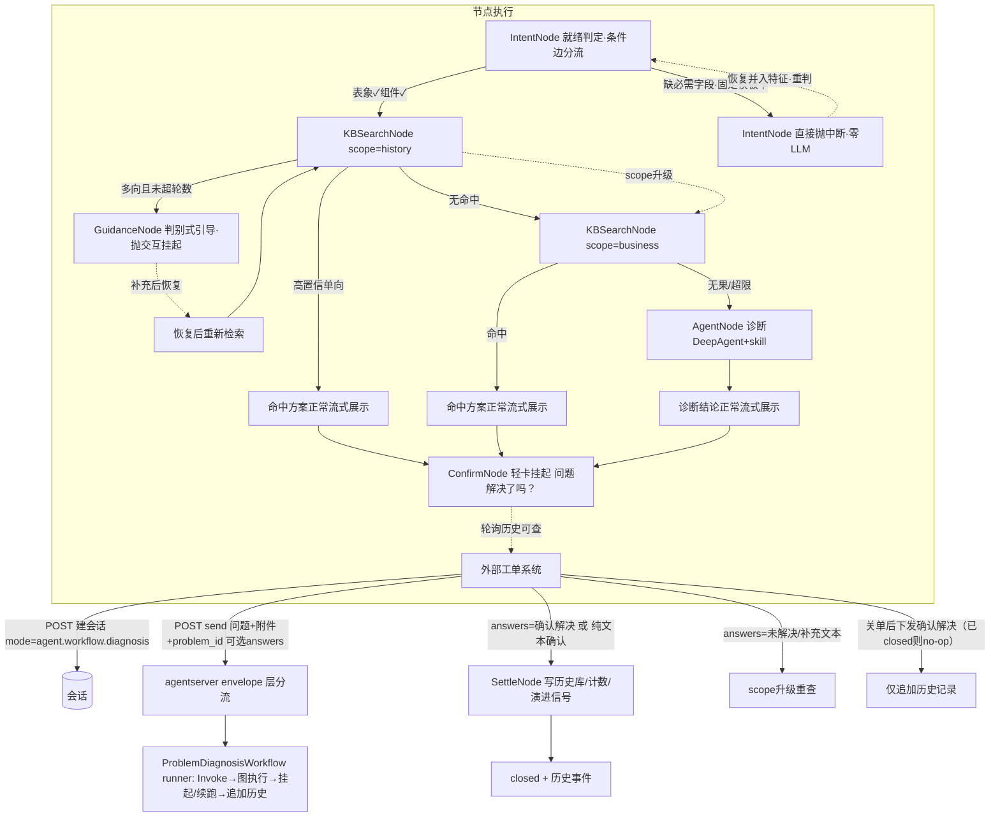
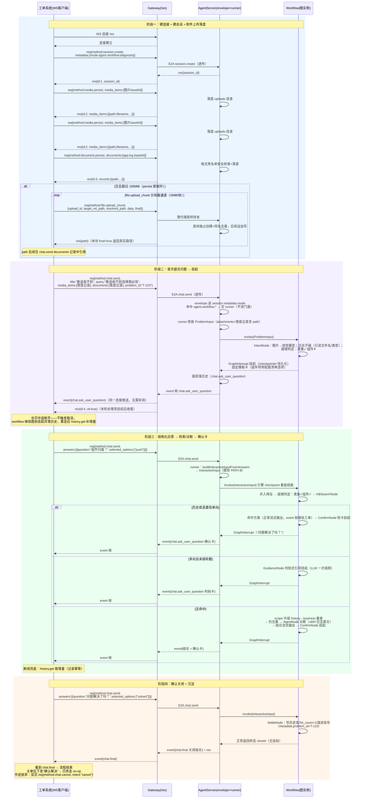

# 问题定位工作流（ProblemDiagnosisWorkflow）设计文档

- 日期：2026-11-26（图内中断统一修订版）
- 状态：待评审
- 命名：工作流本体为**问题定位工作流**（ProblemDiagnosisWorkflow）；"工单"只是 WS 模式的外部载体（工单系统持有工单实体，`problem_id` 为外部回关联字段，与工作流解耦）
- 演进史：2010f2e15 → 3cc09cc96 → daad3edca → 06a13a592 → b49fa96db → 407cc1868（双实例隔离）→ d23eb3f12（统一图内中断）→ e8ab25a55（零自定义事件）→ 本轮（更名 + 单工具收敛）

---

## 1. 需求功能澄清

### 1.1 需求描述

用户提出产品问题（问题描述 + 可选图片/日志附件），按三级链路处理：

1. **第一级·历史知识库**：优先判断问题是否已存在于历史知识库；存在且有解决方案 → 直接返回结果 + 历史问题关联信息（problem_id 回关联工单系统）。
2. **第二级·业务知识库**：历史库未命中或用户反馈未解决 → 业务知识库查询，处理同第一级；但用户确认解决后**只写历史库，业务库不动**。
3. **第三级·Agent 处理**：两级均未成功 → 诊断 Agent（挂专门的问题定位 skill，用户侧预置），触发 skill 结合问题描述与附件日志分析给出结论；用户确认关闭后触发 skill 演进（auto_save 自动落盘，无需确认）。

### 1.2 附加要求

- **越用越准**：历史知识库随闭环沉淀（判重合并计数 + 长尾合并收敛类别）；skill 经 SkillEvolutionRail 自演进。
- **渐进式引导**：新问题召回多个不同方向时，不急于给答案，生成判别式澄清选项引导补充；选项文案来自历史根因分布与区分性特征（历史经验的沉淀形态，非预先配置的目录）。
- **双触发模式**：模式一 WS 会话式（外部工单系统，本 spec 范围——与普通聊天同一 WS 通道/帧协议/方法集，仅 envelope 层按 mode 分流）；模式二聊天问答式（workflow 挂到聊天 agent，第二阶段，契约预留）。两模式为**两个独立 workflow 实例**，见 §2.2。

### 1.3 边界与拍板记录

| 决策点 | 结论 |
|---|---|
| 实现位置 | 本仓（uapclaw-gateway）内，复用既有 KB/agent/skill/HITL 设施 |
| 多租户 | 不做，单用户 |
| 工单实体 | 外部工单系统持有，仅 HTTP 调用触发；两侧靠 `problem_id` 关联 |
| 编排形态 | workflow（PregelGraph）；**统一图内中断模型**（本轮拍板）：等待外部输入 = 图内抛交互挂起（checkpointer 持久化）+ INPUT_REQUIRED；恢复 = 带 `*interaction.InteractiveInput` 重新 Invoke，引擎按 checkpoint 重放续跑 |
| 执行模型 | **图内中断统一**：两模式共用同一恢复协议；聊天恢复执行者 = ReAct 中断桥（现成），HTTP 恢复执行者 = envelope 层 runner 直调 `Workflow.Invoke(InteractiveInput)`（引擎恢复不依赖 ReAct，workflow.go Invoke 入参闭集已含 InteractiveInput） |
| 实例模型 | **双实例共享内核**：HTTP / 聊天 = 两个独立 workflow 执行实例；隔离由 checkpointer 天然承载（挂起态按执行绑定，无需 store 键空间设计）；保留答案归属判定与单活跃实例两条语义规则（§2.3） |
| 分流键 | mode 进 canonical 三段式体系：`agent.workflow.diagnosis`（本轮拍板，方案乙） |
| 分流层 | agentserver envelope 层（handle_message），mode 命中 `agent.workflow.*` 直接交 runner，不进门面（本轮拍板） |
| HTTP 结果通道 | **追加会话历史**（本轮拍板）：复用 AppendHistoryRecord，外部轮询既有历史接口取增量；metadata 只留会话属性，不写 workflow 结果 |
| 知识库引擎 | 历史库与业务库均为 GraphKnowledgeBase（各自独立 collection）；分类树是三元组的查询侧视图，非独立存储 |
| 初始 skill | 用户侧预置提供，本设计只负责装配与触发 |
| 业务库导入面板 | 第二阶段子项目，本 spec 仅定契约（workflow 只依赖契约） |
| 关闭终态 | **用户确认驱动**（本轮拍板）：用户确认解决即 SettleNode 沉淀 → closed；工单系统只从历史读内容、不处理确认，关单后下发"确认解决"走同一 answers 通道（已终态 no-op，用户已补充信息则以诊断流程为准）；`biz_event` 整体删除 |
| 外部字段 | `ticket_id`→`problem_id`、`TicketInput`→`ProblemInput`（外部载体字段与工作流解耦） |

### 1.4 决议总览（2026-11-26/27 头脑风暴终版，正文按此展开）

| # | 决议 | 落点 |
|---|---|---|
| 1 | **统一图内中断模型**：等待=图内抛 GraphInterrupt(8.7)+checkpointer(8.9b) 持久化；恢复=`Workflow.Invoke(*interaction.InteractiveInput)`；废弃 END+store/instance_id 键空间 | §1.3/§2.4/§3.9/§5.5 |
| 2 | **双实例共享内核**：HTTP/聊天两个独立执行实例，checkpointer 按执行绑定天然隔离；共享=图定义+节点库+恢复协议+ProblemInput schema+GraphKB | §2.2 |
| 3 | **恢复执行者分工**：聊天=ReAct 中断桥（WorkflowOutput{INPUT_REQUIRED}+__interaction__ 信封，禁普通 tool result 回喂 LLM）；HTTP=envelope 层 runner 直调 Invoke | §2.4 |
| 4 | **剩余语义规则两条**：答案归属判定（answer_attribution）+单活跃实例（图内中断天然保证） | §2.3 |
| 5 | **mode 三段式** `agent.workflow.diagnosis` 进 canonical 体系（IsWorkflowMode 判前缀） | §2.7 |
| 6 | **分流在 envelope 层**（handle_message 读 metadata mode），不进门面不在 coordinator | §2.7 |
| 7 | **零自定义事件**：挂起/应答/关闭全复用现网 `chat.ask_user_question`/`chat.ask_user_answer`/`chat.final`，外部不感知内部状态 | §2.6/§4.2③ |
| 8 | **问题定位工作流命名**（工单仅为 HTTP 外部载体）；**单工具 `diagnose_problem`**（恢复重放同一 tool call，无 continue/close 工具） | 命名行/§2.2/§4.3 |
| 9 | **命中即挂起原则**：正常 invoke 返回仅限终态（closed/abandoned），补充信息经中断应答直达节点信箱 | §3.1 |
| 10 | **产出与确认分离**：KB 命中方案/Agent 结论正常流式展示（跨节点提交），ConfirmNode 统一轻卡挂起——重放不重播长文 | §3.1/§3.2 |
| 11 | **RouterNode 废除**：Intent 分流降为 Pregel 条件边（8.5 addRouter） | §3.3 |
| 12 | **biz_event 整体删除**：关闭终态用户确认驱动（确认即沉淀）；工单系统仅消费历史，关单下发走同一 answers 通道（终态 no-op） | §1.3/§3.3/§3.8/§4.2② |
| 13 | **HTTP 恢复两形态**：answers（与 web 同款 ask_user 契约，runner 复用同一拆包）/纯文本（节点信箱并入特征） | §4.2② |
| 14 | **Go adapter 回填**：build_inputs.go 补 ask_user 契约完整版（custom_input/__free_text__/interrupt_id 寻址）；permission/client_tool/evolution 缺口 ⤴️ 各自领域 | §6.2 |
| 15 | **已核实现机制**：前端一卡多问（≤4）/多选/custom_input 渲染齐备；中断卡落盘 history 且历史恢复重弹卡（现网既有） | §6.2 |
| 16 | **IntentNode 职责收窄**：只做图片识别（视觉模型）+ 查询文本合成；不碰日志原文、不做规则级抽取，日志分析归 AgentNode；附件元信息（文件名/类型）拼入检索查询 | §3.4 |
| 17 | **开放式澄清固定模板零 LLM**：IntentNode 模糊分支直接抛固定模板中断卡（不路由 GuidanceNode）；GuidanceNode 只保留判别式引导一种形态（从 KBSearch 进）；每轮恢复后回到就绪判定（规则） | §3.4/§3.5 |
| 18 | **最小前置信息集**：必需 = 表象 + 组件归属；增强 = 频率/时间模式、报错信息（口头）、复现步骤；组件选项来自配置的组件清单；必需字段齐 → 就绪 | §3.4 |
| 19 | **HTTP 零新增字段**：ProblemInput 降级为 runner 内部归一化结构，由既有 chat.send params 拼装（description=query、附件对外用 media_items（图片）/documents（文档日志）走既有 normalize 管线、answers=answers（既有 buildInteractiveInputFromAnswers）、problem_id 新增可选 params 键，files 是内部归一化槽位不对外）；HTTP 纯文本下组件识别 = 组件清单关键字匹配，未命中并入表象下轮重问 | §4.3/§7 |
| 20 | **工单走 WS 通道（勘误定案）**：与普通聊天同一 `/ws` 连接/帧协议/方法集，事件帧实时推送、history.get 断线兜底；废除「HTTP 端点 + SSE 断开」方案（unary 阻塞语义与超时不适配长诊断）；断开不触发取消（上游 Python/Go 行为一致，代码实证）；取消须显式 chat.cancel | §2.5/§7 |
| 21 | **输入字段终版（4 个）**：①问题标题 title（必填）②问题描述 description（必填，params["query"]）③附件（可选，双轨上传）④问题单号 problem_id（外部工单必填 / wf 作为 tool 选填）；reproduce_steps 从 schema 删除；校验 = title+description 非空；label/value 为现网 ask_user 既有契约（value 缺省回传 label），复用不扩展 | §4.3/§7.3 |
| CI 结果 | 默认不追踪（规则 11），完成标准 = 本地编译 + vet + 单测 + 集成测试 + 推送 |

---

## 2. 架构设计

### 2.1 总体架构

```
外部工单系统 / 聊天会话
  │
  ▼
agentserver envelope 层（handle_message 分流）
  ├── chat.send 且会话 metadata mode 命中 agent.workflow.* ──▶ ProblemDiagnosisWorkflow runner
  │     start：Invoke(ProblemInput) → 图执行 → 等待节点抛交互挂起 → INPUT_REQUIRED
  │     resume：Invoke(*interaction.InteractiveInput) → 引擎按 checkpoint 重放续跑
  │     每次状态变更 → 追加历史记录 → 返回
  ├── 其余 chat.* ──▶ 既有门面链路（ExecuteMessageStream / ProcessMessage，零改动）
  ──▶ 既有 KB / DeepAgent / SkillEvolutionRail / GraphInterrupt(8.7) / checkpointer(8.9b) 组件（零改动）
```

### 2.2 双实例共享内核

**两模式是两个独立 workflow 执行实例，不是"一套机制对外呈现两种样子"。** 每次诊断 = 一次图执行实例（挂起态由 checkpointer 按执行绑定，天然隔离）；HTTP 实例由工单系统建会话触发，聊天实例由 DeepAgent 工具调起，互不感知。

**同源内核（共享资产）：**

| 共享面 | 内容 |
|---|---|
| 图定义与节点库函数 | §3 六节点实现（Router/Intent/Guidance/KBSearch/Agent/Settle）+ 状态转移表（§3.3） |
| 执行与恢复协议 | 统一图内中断：Invoke(ProblemInput) 启动 / Invoke(InteractiveInput) 恢复，checkpointer（8.9b 持久 KV）承载挂起态 |
| ProblemInput schema | §4.3 同构入参 + 校验规则（"description 非空"） |
| GraphKB | 历史库 + 业务库 + SettleNode 落库函数——唯一共享数据面，跨实例知识流动只经此 |

**各自适配面（互不相同，各自成立）：**

| | HTTP 实例（本 spec 范围） | 聊天实例（第二阶段） |
|---|---|---|
| 入口 | envelope 层分流直调 runner | DeepAgent 调 `diagnose_problem` 工具（**单工具**，本轮拍板：恢复走中断应答通道重放同一 tool call，无需 continue/close 工具） |
| 恢复执行者 | runner 直调 `Workflow.Invoke(InteractiveInput)`（answers/纯文本映射为恢复输入） | ReAct 中断桥重放 tool call（现成，见 §2.4） |
| 等待呈现 | 追加历史记录（事件流），外部轮询历史接口可见 pending 交互 | 经 ReAct 中断信封发 ask_user 卡片（见 §2.4） |
| 输入解释 | send 中 `answers`/纯文本（结构化与自由文本同构） | 卡片结构化 answers 直读（不经 LLM 猜测） |
| 输出表达 | 追加历史记录（结构化事件载荷） | AgentNode 结论走会话 chunk → final |

### 2.3 语义规则（图内中断模型下的剩余约束）

执行态隔离由 checkpointer 天然承载（挂起态按执行实例绑定，随 tool_call/执行生命周期走），原 END+store 模型下的 instance_id 键空间条款**作废**。剩余两条与执行模型无关的语义规则：

1. **答案归属判定**：挂起期间到达的自由文本输入，先经归属判定（复用 interrupt 包 answer_attribution 机制）：是当前 pending 交互的应答 → 作为 InteractiveInput 恢复执行；明显是新话题 → 不消费，作为普通用户消息走 ReAct 新一轮（由 DeepAgent 决定开新诊断或提醒先回应挂起卡片）。HTTP 侧同理：与 pending 选项无关的 send 视为补充特征并入恢复输入。
2. **单活跃实例**（图内中断天然保证）：会话挂起在 pending 交互上时，聊天侧会话本身挂起、不可能再调 `diagnose_problem`；HTTP 侧 runner 收到 start 类输入且存在活跃 checkpoint 时直接返回"已有进行中的诊断"提示。同一会话多诊断并行在图内中断模型下无发生面。

### 2.4 统一中断信封与恢复协议

等待载荷**禁止以普通 tool result 返回**（LLM 会拿到继续推理）。两模式共用引擎的图内中断，差异仅在恢复执行者：

```
启动（两模式同构）：
  Invoke(ProblemInput) → 图执行 → 等待节点（Guidance/Confirm）抛 GraphInterrupt（8.7）
  → 引擎挂起，执行态写 checkpointer（8.9b 持久 KV，跨时间 gap 可恢复）
  → WorkflowOutput{State: INPUT_REQUIRED, result: [__interaction__ 等待载荷]}
  → 等待载荷追加进历史记录（外部轮询可见）

聊天恢复（第二阶段，现成机制 react_workflow_interrupt.go）：
  用户点选/补充 → handleResumeWorkflow：回写 ai_message → 恢复输入经
  WorkflowResumeInputsKey 旁路注入 → executeToolCalls 重放 tool call
  → Workflow.Invoke(*interaction.InteractiveInput) → 引擎 checkpoint 重放续跑
  → 结果不含普通 tool result 回喂 LLM；再遇等待 → 再中断（多轮天然支持）
  → 全完成 → ResumeStartIterationKey 续跑 ReAct 循环

HTTP 恢复（runner 承担恢复执行者角色，协议同一）：
  工单 send（answers / 补充文本）→ envelope 分流 → runner 将其映射为
  *interaction.InteractiveInput → Workflow.Invoke → 引擎 checkpoint 重放续跑
  → 跑到下一等待（再追加历史）或终态（closed/abandoned）
```

挂起态唯一承载 = checkpointer（按执行绑定）；聊天侧 ReAct 层的 InterruptionState 只额外保存"tool call + 答案收集器 + AIMessage"用于会话恢复，不承载诊断状态。

**HTTP runner 职责清单**：持有 workflow 组件引用；从最近一次 INPUT_REQUIRED 输出/历史记录解析 pending component_id；把 send 输入映射为 InteractiveInput（component_id + answers）；调 Invoke 恢复；把每轮结果追加历史。

### 2.5 通道转发

外部工单与普通聊天走**同一 WS 通道**（本轮拍板）→ gateway web channel → transport `SendRequest/SendRequestNoWait`（E2A）→ agentserver，协议零改动：

- 工单复用 web 前端的连接/帧协议/方法集（session.create、media.persist、document.persist、chat.send、history.get、chat.cancel），事件帧实时推送，history.get 为断线兜底；断开不触发取消（上游 Python/Go 一致，§7）；
- ticket 模式 workflow 执行不产流式帧，E2A 响应事件通道不被占用，普通流式会话不受影响；
- 分流点在 agentserver envelope 层（收到 E2A 请求之后），gateway 只透传。

### 2.6 帧与结果纪律（防污染）

1. **结果只进历史，且零自定义事件**（本轮拍板）：统一走中断后，全部复用现网白名单事件类型——引导/确认挂起 = `chat.ask_user_question`（AskUserQuestionPayload.questions，含 options/multi_select，前端已有渲染且历史恢复可重弹）、用户回答 = `chat.ask_user_answer`、关闭结论 = `chat.final`。**不定义 ticket 专用 event_type，外部不感知内部状态**（想知道"等什么"看最新一条未配对的 ask_user_question 即可）；**不产流式帧**；不写 metadata。
2. 聊天模式等待载荷只经 §2.4 中断信封呈现，禁止以普通 tool result 返回。
3. `Guidance`/`Confirm` 两模式经同一 ask_user 卡契约呈现；web 前端渲染卡片，工单系统按同一载荷渲染自有 UI 或直接回传文本/状态事件。

### 2.7 分流层定位（本轮拍板）

- **分流在 agentserver envelope 层（handle_message）**，不在门面、不在 coordinator：
  - chat.send 进入 envelope 分发时读 `GetSessionMetadata(sessionID)` 的 mode，命中 `agent.workflow.*` → 直接交 ProblemDiagnosisWorkflow runner；
  - 不进门面：跳过普通对话路径的 `AppendHistoryRecord`、`BuildInputs`、云端记忆钩子、adapter 构造——workflow 不是对话链路（其事件经 runner 主动追加历史，见 §2.6）；
  - coordinator 层（`runViaExecutionCoordinator`）只做执行登记，不懂业务 mode——workflow 图执行不经 coordinator 账本（实施时按 writing-plans 细化）。
- **mode 键设计**：`agent.workflow.diagnosis` 进 canonical 三段式体系——schema 加常量 + `modeClassifier.IsWorkflowMode`（判前缀 `agent.workflow.`，新增 workflow 类型免改分类器）；mode 显式覆盖式写入复用 `SyncSessionRequestMetadata` 既有语义（建会话时锁定，会话生命周期内不可变）。
- **为什么不消息级路由**：会话级固定 mode 保证"一个实例一套状态"的边界；消息级混跑与实例隔离冲突，不在本 spec 范围。

### 2.8 渐进式自迭代机制（核心）

- **归因库沉淀**：分类树不是预先配置的目录，而是历史经验的沉淀形态——每次关闭时从"表象+真实根因+方案"抽取四元组（表象特征/根因类别/区分性特征/解决方案），以三元组链写入历史 GraphKB；"树"是三元组按表象相似度聚合的查询侧视图；
- **引导 = 用历史根因分布反推的判别式提问**：召回候选按根因聚类，同一表象对应多个根因 → 从各类根因的区分性特征构造判别问题（"偶发还是必现？""日志有无 X 关键字？"）；
- **判定规则化、生成 LLM 化**：该不该引导/几轮/超限路由全是规则；LLM 只在触发引导时一次调用（聚类+文案）；
- **长尾合并**：沉淀时新根因类别先在既有类别中语义匹配（embedding 近邻），`hit_count<3` 且近邻相似度>阈值 → 指向近邻；`hit_count≥3` 才自立节点；类别集合收敛不爆炸；
- 冷启动期历史少、召回少，直接给答案或跳级，引导不会空转；引导质量随"同表象多根因"案例增长自动提升，机制零改动。

---

## 3. Workflow 节点设计

### 3.1 节点与状态

节点（图节点，6 个）与阶段标记（图状态字段）是两个层面：

| 节点 | 职责 | 产出的阶段 |
|---|---|---|
| IntentNode | 附件预处理（仅图片→视觉模型；日志不碰）+ 就绪判定（必需=表象+组件）；输出后接 Pregel 条件边分流（§3.3） | `searching` 等 |
| GuidanceNode | 渐进式引导：开放式澄清 / 判别式选项（多问卡 ≤4 问，一卡多问+多选+custom_input；抛交互挂起） | `guiding` |
| KBSearchNode | GraphRetriever 检索（scope 参数化），方向判定；**命中方案正常流式输出展示**（同 AgentNode，跨节点提交），完成后汇入 ConfirmNode | `wait_confirm` |
| AgentNode | 诊断 DeepAgent（skill + 附件日志分析）；**结论正常流式输出到界面**（会话 chunk，不走卡片），完成后汇入 ConfirmNode | `wait_confirm` |
| ConfirmNode | **两条路径（KB 命中 / Agent 诊断）的统一确认节点**：轻卡挂起（"问题解决了吗？" + 确认解决/未解决选项）——产出与确认分离，重放只重做本节点不重播方案/结论长文 | `wait_confirm` |
| SettleNode | 关闭后归档：写历史库 / 命中计数 / 演进信号 | `closed` / `abandoned` |

每次执行遇 `guiding` / `wait_confirm` 在图内抛交互挂起（checkpointer 承载），执行体不驻留进程内等待。

**命中即挂起原则**（本轮拍板）：三级链路中任何"需要用户表态"的点（方案确认、引导补充）一律抛交互挂起；**正常 invoke 返回仅发生在终态（closed/abandoned）**——不存在"返回方案后会话结束、用户补充后需重新进图"的中间态，补充信息经中断应答通道直达节点信箱（workflow 分支 buildInteractiveInput 的 UserInputs 兜底），引擎重放即续跑。这也是单工具 `diagnose_problem` 成立的前提。

### 3.2 全局流程图



### 3.3 图分支（原 RouterNode 职责的归宿）

图内中断模型下无"重进路由"，RouterNode 作为节点**废除**：

- **Intent 前置分流**（特征全模糊 → GuidanceNode / 特征就绪 → KBSearchNode）= IntentNode 输出后的 **Pregel 条件边**（8.5 addRouter），非独立节点；
- **确认卡应答（确认解决/未解决）是恢复输入**，由 ConfirmNode 直接消费；工单系统关单后下发的确认解决走同一 answers 通道，已终态则 no-op；
- scope 升级（history→business→agent 只进不退）由 KBSearchNode/AgentNode 协作承担。

状态转移表：

```
init ──缺必需字段──▶ 固定模板卡挂起（零 LLM，重判规则见 §3.4）
init ──必需字段齐──▶ searching
guiding ──用户补充──▶ searching（scope 不变，重新检索）
searching ──历史库高置信单向──▶ wait_confirm（历史方案+ticket关联）
searching ──历史库多向──▶ guiding（判别式引导）
searching ──历史库无命中──▶ searching（scope=business 重查）
searching ──业务库命中──▶ wait_confirm（业务库方案）
wait_confirm ──确认解决──▶ SettleNode ──▶ closed（确认即沉淀，无 close 等待态）
wait_confirm ──未解决 / 补充文本──▶ scope 升级重查或 AgentNode
轮数超限/scope 已到顶 ──▶ AgentNode
```

### 3.4 IntentNode

职责收窄（本轮拍板，决议 16/17/18）：**只做图片识别 + 查询文本合成 + 就绪判定，不碰日志原文**——日志分析归 AgentNode（挂诊断 skill + 附件读取工具）。

1. **附件预处理**：仅处理图片附件 → 视觉模型（多模态 LLM）抽现象特征（错误码/界面异常/堆栈）；视觉模型走配置，无多模态时降级跳过并 Warn；**日志附件不解析**，仅取文件名/类型元信息拼入检索查询；
2. **特征归集**：表象取 ProblemInput.title + description（零提取）；组件归属来自用户应答（卡片选项/纯文本清单匹配）；产出结构化特征 `{表象, 组件, 特征...}`（键值，非向量）；
3. **就绪判定（规则，零 LLM）**：必需字段 = 表象 + 组件归属，两者非空 → 就绪；缺 → 抛固定模板中断卡（只列缺的字段，组件项带配置清单选项），计入 `guidance_rounds`；**每轮恢复输入并入特征后回到本判定**，超限（2~3 轮，可配）带着已有特征进 KBSearchNode 兜底；
4. 检索查询文本合成（title+description 双字段定案）：**title 做主题锚 + description 做区分度**——`查询文本 = title（开头一句锚定主题）+ description（错误细节/现象特征）+ 图片识别结果 + 附件元信息`（图片先转文字再入查询）。只用 title 会缺细节召回泛化；只用 description 长文本语义稀释、主题漂移；title 在最前锚定重心是检索实践的 title-boost 标准合成。title 同时独立用于历史库 `metadata.title`（展示/回关联/同标题优先聚合），不进向量。

### 3.5 GuidanceNode（仅判别式引导，本轮拍板）

| 形态 | 触发（规则） | 生成（LLM 一次调用） |
|---|---|---|
| 判别式引导 | 召回候选根因类别数 ≥2 | 候选按根因聚类 + 从各类区分性特征生成判别问题文案（含命中次数提示） |

开放式澄清**不再是 GuidanceNode 形态**（决议 17）：IntentNode 模糊分支直接抛固定模板中断卡（零 LLM，见 §3.4 第 3 条）。轮数上限 2~3（可配置），开放式模板卡与判别式引导合并计数（图状态 `guidance_rounds`）；超限自动进下一级。判定全规则、不进 LLM；LLM 只干语义工作。

### 3.6 KBSearchNode

- **复用 `GraphRetriever`，不自建查询管线**：其原生流程即"chunk 检索 + beam search 图扩展（消费 `kb_{id}_triples`）+ RRF k=60 融合"；HybridRetriever 为向量+稀疏 alpha 权重路由（默认 0.5），融合在 store 层；
- 流程：混合召回（原始完整语句）→ reranker 阈值粗筛（score<阈值剔除）→ LLM 聚类丢弃无关（标记 irrelevant）→ `hit_count` 业务加权（`final_score = rrf_score × f(log(hit_count))`，检索器外编排层做）→ 三元组两跳（表象→根因类别→组件）验证方向 → 单向高置信出方案 / 多向触发引导；
- scope=history 与 scope=business 同构，参数化复用。

实际例子（表象"收不到消息"，历史两个根因方向）：

1. IntentNode：抽特征 `{表象:"收不到消息", 组件:"推送服务"}`；
2. 混合检索：召回案例 A（下游限流）、B（证书过期）；
3. 三元组两跳：第一跳得根因分布 {下游限流, 证书过期}；第二跳 `predicate=影响` 验证两方向均吻合组件 → 双向并存 → 触发引导；
4. LLM 一次调用：候选聚类 + 判别问题文案（"偶发还是必现？""日志有无 TLS/证书关键字？"）；
5. 用户补充（"偶发，仅高峰期"）→ 特征并入 → 重新检索 → 单向 → 返回方案 + ticket 关联 + 确认；
6. 关闭 → SettleNode（命中案例 `hit_count+1`）。

### 3.7 AgentNode

- 诊断 DeepAgent 走与普通会话相同的 DeepAdapter/会话管线，差异仅在装配参数：
  - **skills**：用户预置诊断 skill 专用目录，`skill_mode=auto_list` 注入（SkillUseRail 现成）；
  - **rails**：SkillEvolutionRail（`enabled=true` + `auto_save=true`）+ 既有基础 rails；
  - **提示词**：诊断场景模板（逐字管理）+ 上下文注入（intent 特征序列化文本、trail、附件引用）；
  - **工具**：skill 触发、日志/附件读取（复用仓内附件通道）；
- SettleNode 关闭时注入演进信号（`handleEvolutionFromSignals`），skill 经验自动落盘（SkillCreateRail 护栏覆盖新 skill 创建场景）；
- 所有节点的 LLM 调用走既有模型配置体系（user config / model routing），节点 prompt 模板独立文件；可按节点配不同档位模型（抽取用便宜模型、agent 用主力模型）。

### 3.8 SettleNode

由 ConfirmNode 的确认解决应答触发（确认即沉淀，无 close 等待态；工单系统关单下发仅在未终态时等同确认解决应答，已终态 no-op）。按 scope 分流落库（SettleNode 本身不含智能，只做路由分发）：

| 处理路径 | 落库动作 | 判重 |
|---|---|---|
| 历史库命中 | 命中案例 `hit_count+1`，增量并入 text（doc_id 已记录） | 无需（同标题案例优先聚合） |
| 业务库命中 | 写历史库新文档；**业务库不动** | 轻判重（一次向量相似度查询） |
| AgentNode 处理 | 写历史库全量新文档（含排查链路、附件摘要） | 轻判重（同上） |

轻判重：表象向量与历史库比对，超阈值且根因同向 → 并入既有案例 +1；否则 `AddDocuments`（含三元组抽取 + 长尾合并规则 §2.8）。两条路径均写 `metadata.problem_id`；agent 路径额外注入演进信号。abandon 不沉淀不演进。

### 3.9 跨轮上下文（图状态 + checkpointer 承载）

图内中断模型下，跨轮上下文（intent_features / guidance_rounds / scope / hit_doc_ids / trail）作为**图状态**由执行实例携带，挂起时随执行态写入 checkpointer（8.9b 持久 KV）——恢复时重放即可见，无需任何外部 store 键设计：

- `intent_features`：累积结构化特征（键值），每轮合并；
- `guidance_rounds`：已引导次数（上限可配）；
- `scope`：当前库级 history→business→agent；
- `hit_doc_ids`：历史命中案例 doc_id（关闭时直接 `hit_count+1`，零判重）；
- trail（可选，YAGNI 可缓）：各节点检索/结论摘要，供沉淀文档正文与最终展示拼装。

---

## 4. API 设计

### 4.1 原则

零新增 URL；复用既有会话创建 / send / 历史读取接口；扩展点全部为可选字段，向后兼容。

### 4.2 接口清单

**① 会话创建**（既有 POST）：session metadata `mode=agent.workflow.diagnosis`（会话级固定，显式覆盖式写入即锁定）。

**② send**（既有 POST `/api/v1/chat/send`，请求体即既有 chat.send params 零新增字段，决议 19）：ProblemInput 不作为独立请求体 schema，而是 runner 从既有 params 拼装的内部归一化结构（§4.3）；可选 `problem_id` 为唯一新增 params 键（HTTP 侧回关联）；`answers` 复用既有 `buildInteractiveInputFromAnswers` 拆包（build_inputs.go PATH B）：

```json
{
  "title": "推送消息收不到",
  "query": "推送消息收不到，高峰期必现",
  "media_items": [{"type": "image", "filename": "screenshot.png", "path": "/uploads/.../screenshot.png"}],
  "documents": [{"type": "document", "filename": "app.log", "path": "/uploads/.../app.log"}],
  "files": {"uploaded_images": [{"filename": "screenshot.png", "path": "/uploads/.../screenshot.png", "mime_type": "image/png", "size_bytes": 12345}],
            "uploaded_documents": [{"filename": "app.log", "path": "/uploads/.../app.log", "mime_type": "text/plain", "size_bytes": 67890}]},
  "problem_id": "T-123",
  "answers": [{"question": "组件归属？", "selected_options": ["push"], "custom_input": ""}]
}
```

**附件两阶段契约**（与 web 前端同一流程，决议 19）：先经 `POST /sessions/{id}/media`（media.persist）与 `POST /sessions/{id}/documents`（document.persist，含格式黑名单安全检查）上传落盘，chat.send 只引用落盘记录（path，带 filename/mime_type/size_bytes），base64 不进 chat.send；`files` 摘要为 web 前端行为（供普通对话链路 BuildUserPrompt 消费），工单侧不传。runner 拼装 ProblemInput 时附件即含落盘 path——IntentNode 仅读元信息（文件名/类型），AgentNode 按 path 读日志原文，顺序天然满足。

| 恢复形态 | 语义 | runner 处理 |
|---|---|---|
| `answers` 数组 | 结构化回答（工单系统按历史里 ask_user_question 载荷渲染自有 UI；含确认解决/未解决/组件选项） | 复用既有 `buildInteractiveInputFromAnswers` 拆包 → InteractiveInput → Invoke 恢复 |
| 纯文本（query） | 自由文本 | 组件清单关键字匹配（命中填 component；未命中整段并入表象，下轮卡再列组件项，零 LLM）；关单后下发的确认解决同样以此形态到达 |

|---|---|
| 不传 | 普通评论：并入特征，scope 升级重查（wait_confirm 态）/主流程（初态） |
| `confirm_solved` | 置待归档标记，等 close |
| `not_solved` | scope 升级：history→business→agent |
| `close` | 进 SettleNode 落库+演进，置 closed |

附件走**两阶段契约**（先 media.persist / document.persist 上传落盘拿 path，chat.send 只引用落盘记录），安全检查在上传端点完成（图片校验 + 文档格式黑名单）。

**③ 结果读取 = 轮询既有历史接口，复用现网事件类型（本轮拍板，零自定义事件）**：

- 引导/确认挂起 → `chat.ask_user_question` 记录（AskUserQuestionPayload.questions：question/options/multi_select，含完整选项列表——与现网 ask_user 中断落盘形态一致，web 历史恢复可重弹卡）：

```json
{"role": "assistant", "event_type": "chat.ask_user_question",
 "questions": [
   {"question": "是偶发还是必现？", "options": [{"label":"偶发","value":"transient"}, {"label":"必现","value":"always"}],
    "multi_select": false, "header": "现象特征"},
   {"question": "还有其他线索？", "header": "补充", "options": []}
 ],
 "problem_id": "T-123"}
```

- 用户回答 → `chat.ask_user_answer`（answers 数组，question 绑定；含 selected_options/custom_input）；
- 关闭沉淀完成 → `chat.final`（最终结论文本，白名单内正常消息）；
- 外部工单系统轮询历史接口取增量（记录自带 id/时间戳，幂等）；**不感知内部 state 字段**——"当前等待什么" = 最新一条未配对的 ask_user_question；
- **metadata 只留会话属性**（mode/channel_id/...），不写任何 workflow 结果——同普通聊天的属性刷新语义；
- 前端事实（已核）：`historyRestore.ts` 白名单 `ALLOWED_ASSISTANT_EVENT_TYPES` 含 ask_user_question/answer 与 chat.final——ticket 会话在 web 打开可重弹挂起卡（运营可接管），无空泡渲染风险。

**④ 聊天模式接入（第二阶段，契约预留）**：聊天 DeepAgent 装**单工具 `diagnose_problem`**（§2.2/§4.3），中断信封与恢复接缝见 §2.4；结论走会话 chunk→final。前端零改动。

### 4.3 ProblemInput：runner 内部归一化结构（本轮拍板，决议 19）

ProblemInput **不是 HTTP 请求体 schema**（HTTP 复用既有 chat.send params 零新增字段），而是 runner 从 params 拼装的内部归一化结构；聊天侧 `diagnose_problem` 单工具参数仍用它定义，两侧在 runner 内汇合同构：

```
ProblemInput（runner 内部视角，输入字段终版·决议 21）{
  title           string  必填（问题标题；来自 params["title"]（新增可选键，自由 map 透传）/ 工具参数 title）
  description     string  必填（问题描述；来自 params["query"] / 工具参数 description）
  attachments     list    可选（图片/文档；media.persist / document.persist 上传落盘，chat.send 引用落盘记录，base64 不进 chat.send）
  problem_id      string  问题单号（外部工单必填，params["problem_id"]，回关联；wf 作为 tool 选填）
}
```

- 校验规则 = "title 非空 + description 非空"，与工具/HTTP 同一套；复现步骤不再作为独立输入字段（决议 21，并入 description 文本或经澄清卡收集）；
- **必需前置信息集**（决议 18）：表象（title+description）+ 组件归属；组件选项来自配置的组件清单，经固定模板中断卡收集；
- 挂起后恢复不经工具——应答经中断通道（ask_user 卡 / answers）回流，ReAct 重放同一 tool call；HTTP 侧经 `buildInteractiveInputFromAnswers`；
- 多轮补充：两侧同构并入 `intent_features`——工具侧来自对话消息，HTTP 侧来自 send 纯文本/answers，进入状态机后完全同构。

---

## 5. 数据库设计

### 5.1 存储形态

历史库与业务库各为一个 GraphKnowledgeBase collection。GraphKB 的三元组索引**不是图数据库也没有关系表**——三元组转文本 chunk 写入第二个向量 collection。即一个 KB = 两个向量 collection，无关系表、无外键；关联靠 `case_doc_id` 与实体名共指，查询侧 join。

### 5.2 历史库表结构

**表 1 `kb_history_chunks`（案例文档，一个历史问题一条记录）**

| 字段 | 类型 | 内容 |
|---|---|---|
| doc_id | string | 历史问题唯一 id |
| text | string | 完整叙述：**开头=title+description（与查询侧形态对称）**+排查过程+根因+方案（向量召回主体） |
| vector | float32[] | text 的 embedding |
| metadata.problem_id | string | 工单系统 id（回关联） |
| metadata.component | string | 归属组件（检索过滤） |
| metadata.title | string | 问题标题（工单回关联展示/chat.final 结论文案引用/长尾合并同标题优先聚合；不进向量） |
| metadata.hit_count | int | 被召回/确认次数（业务加权与展示） |
| metadata.settled_at | int64 | 沉淀时间 |

**表 2 `kb_history_triples`（三元组，一个案例多条记录）**

| 字段 | 类型 | 内容 |
|---|---|---|
| triple_id | string | 三元组唯一 id |
| text(caption) | string | "主语 -谓语-> 宾语"叙述句（embedding，实体语义匹配用） |
| vector | float32[] | caption embedding（辅助：长尾合并找近邻类别；主链路以 metadata 过滤为主） |
| metadata.subject / predicate / object | string | 实体与谓词 |
| metadata.subject_type / object_type | string | 枚举：表象 / 根因类别 / 组件 / 方案 |
| metadata.case_doc_id | string | 指回表 1 案例 |
| metadata.hit_count | int | 该三元组命中次数 |

### 5.3 谓词与合法边（校验器限定，非法组合写不进）

| predicate | 合法组合 | 用途 |
|---|---|---|
| 归类 | 表象 → 根因类别 | 案例归因 |
| 方案 | 根因类别 → 方案 | 该类根因怎么修 |
| 影响 | 根因类别 → 组件 | 根因↔组件关系 |

组件归属不进三元组（表 1 `metadata.component` 承担）；实体不单独建表；"分类树"是三元组按表象相似度聚合的查询侧视图。

### 5.4 业务库表结构

独立 GraphKB collection（`kb_business_*`），结构与 §5.2 同构，内容由导入面板写入（第二阶段）：人工导入的产品文档（PDF/Word/MD/网页，参考 WeKnora 模式）经解析分块（复用 13.x chunker 系列）+ 三元组抽取后落库；含 collection 管理、导入进度/失败重试、文档删除。workflow 只依赖导入契约（GraphKB `AddDocuments` 写入面 + collection 管理接口）。

### 5.5 会话状态存储

诊断进度（图状态）由 checkpointer（8.9b Persistence KV）按执行实例承载，挂起/恢复/跨时间 gap 均经 checkpoint 重放——**无独立 workflow store、无键空间设计**。面向外部的事件载荷走历史记录（§4.2③）。

---

## 6. 测试策略与遗留

### 6.1 测试策略

1. **单测**：真实 KB 会话管线验证（真实链纪律——禁窄接口/替身承载能力面；函数参数收具体类型）；GraphRetriever/判重规则/长尾合并/状态转移表逐一覆盖，目标 ≥85%；
2. **集成测试**：覆盖"建会话→引导→确认→关闭落库→演进信号"全链，真实跨 KB/agent/checkpointer ≥3 子系统（满足集成审计两层门禁）；确认卡两态（解决/未解决）与轮数超限分支必测；挂起/恢复必测（跨 Invoke 恢复后图状态续跑正确、恢复输入只进绑定执行）；
3. **mock 只在边界**：HTTP 端点、LLM 端点；不得 mock 被测子系统本身。

### 6.2 已知偏差与遗留

- 无对齐上游场景（平台自有业务编排流），不存在 Python 对照问题；
- 遗留：业务库导入面板第二阶段；trail 字段第一版可缓（YAGNI）；定期类别合并任务不做（沉淀时规则已覆盖）；聊天模式接入第二阶段（§2.4 统一中断协议契约已预留）；历史接口 `since` 增量参数若既有接口不具备则在本 spec 实施时定义参数级扩展。

---

## 7. 全链路交互时序（WS 会话式，四级泳道；本轮拍板：工单与普通聊天同一 WS 逻辑）

参与方：**工单系统**（WS 客户端）→ **Gateway**（`/ws` WebSocket 端点，web channel）→ **AgentServer**（envelope 分流 + ProblemDiagnosisWorkflow runner）→ **Workflow**（PregelGraph 图执行实例）。

**核心拍板（勘误定案）**：工单系统接入**不走专用 HTTP 端点，直接复用普通聊天的 WS 通道**——同一 `/ws` 连接、同一 req/res/event 帧协议、同一方法集；唯一差异在 agentserver envelope 层按会话 metadata mode 命中 `agent.workflow.*` 分流给 runner，工单系统不感知分流存在。上游 Python 行为一致（jiuwenswarm `web_http_routes.py:773-780` SSE 断开仅 break + 注销 outbound，无反向 cancel；Go 同）。

**断开语义**（代码实证，上游一致）：WS/SSE 断开均**不触发取消**（Go：web_connect.go:210 仅移除连接；Python：web_http_routes.py:773 仅 break）——agentserver 执行不依赖连接存活，工单断开后 workflow 照常跑到挂起/终态并落历史；真正取消必须显式发 `chat.cancel`（intent=cancel）。

### 7.1 时序图



### 7.2 帧交互示例

**① 建会话**

```
→ {"type":"req","id":"1","method":"session.create",
   "params":{"metadata":{"mode":"agent.workflow.diagnosis"}}}
← {"type":"res","id":"1","ok":true,
   "payload":{"session_id":"web_xxx","metadata":{"mode":"agent.workflow.diagnosis"}}}
```

**② 附件上传落盘（先于 send）**

```
→ {"type":"req","id":"2","method":"media.persist",
   "params":{"session_id":"web_xxx","content":"",
             "media_items":[{"type":"image","filename":"screenshot.png","data":"<base64>"}]}}
← {"type":"res","id":"2","ok":true,
   "payload":{"media_items":[{"type":"image","filename":"screenshot.png",
     "path":"/uploads/web_xxx/screenshot.png","mime_type":"image/png","size_bytes":12345}]}}

→ {"type":"req","id":"3","method":"document.persist",
   "params":{"session_id":"web_xxx","content":"",
             "documents":[{"type":"document","filename":"app.log","data":"<base64>"}]}}
← {"type":"res","id":"3","ok":true,
   "payload":{"records":[{"type":"document","filename":"app.log",
     "path":"/uploads/web_xxx/app.log","mime_type":"text/plain","size_bytes":67890}]}}

# 备通道：日志超过 100MiB（document.persist 拒收）时走 file.upload_chunk 分块
→ {"type":"req","id":"3a","method":"file.upload_chunk",
   "params":{"session_id":"web_xxx",
             "upload_id":"ticket-log-1","target_rel_path":"agent/sessions/web_xxx/uploads/app.log",
             "resolved_path":"","data":"<2MiB base64 块>","final":false}}
← {"type":"res","id":"3a","ok":true,"payload":{"path":"/uploads/web_xxx/app.log.part"}}
# ... 逐块续传（resolved_path 取上一块返回值；首块服务端同名自动去重），末块 final=true：
→ {"type":"req","id":"3n","method":"file.upload_chunk",
   "params":{"session_id":"web_xxx",
             "upload_id":"ticket-log-1","target_rel_path":"agent/sessions/web_xxx/uploads/app.log",
             "resolved_path":"/uploads/web_xxx/app.log.part","data":"<尾部块>","final":true}}
← {"type":"res","id":"3n","ok":true,"payload":{"path":"/uploads/web_xxx/app.log"}}
```

**③ 首次 send（只引用落盘记录，不带 base64）**

```
→ {"type":"req","id":"4","method":"chat.send",
   "params":{"session_id":"web_xxx","title":"推送消息收不到",
             "query":"推送消息收不到，高峰期必现",
             "media_items":[{"type":"image","filename":"screenshot.png","path":"/uploads/web_xxx/screenshot.png"}],
             "documents":[{"type":"document","filename":"app.log","path":"/uploads/web_xxx/app.log"}],
             "problem_id":"T-123"}}
← event 帧（本轮执行到挂起后推送）：
{"type":"event","event":"chat.ask_user_question","payload":{
   "questions":[{"question":"问题发生在哪个组件？","header":"组件归属",
     "options":[{"label":"推送服务","value":"push"},{"label":"接入网关","value":"gateway"},
                {"label":"存储层","value":"storage"}],"multi_select":false}],
   "problem_id":"T-123"}}
← {"type":"res","id":"4","ok":true}
```

**④ 恢复应答（结构化 answers）**

帧序说明（现网实证，前端 useWebSocket.ts:2844 + 上游 interface.py:500-534）：ask_user 应答上行 = `chat.send` 带 `answers`+`request_id`（`chat.user_answer` 是自进化确认等场景的另一个方法，ask_user 卡不走）；agentserver 经 `_is_ask_user_answer_resume` 识别后落 `chat.ask_user_answer` 历史记录，恢复的工具调用随后推下行 `chat.tool_result` 事件帧闭合前端工具卡片——联调时勿把下行展示帧误认作应答通道。

```
→ {"type":"req","id":"5","method":"chat.send",
   "params":{"session_id":"web_xxx",
             "answers":[{"question":"问题发生在哪个组件？","selected_options":["push"],"custom_input":""}]}}
← event{chat.ask_user_answer} + 方案/结论 event 帧 + 后续 ask_user 卡 event 帧
← {"type":"res","id":"5","ok":true}
```

**⑤ 确认解决 → 终态**

```
→ {"type":"req","id":"6","method":"chat.send",
   "params":{"session_id":"web_xxx",
             "answers":[{"question":"问题解决了吗？","selected_options":["solved"]}]}}
← {"type":"event","event":"chat.final",
   "payload":{"content":"问题已关闭并沉淀至历史知识库（关联 T-123）"}}
← {"type":"res","id":"6","ok":true}
```

**⑥ 中途取消**

```
→ {"type":"req","id":"7","method":"chat.cancel","params":{"intent":"cancel"}}
```

**语义要点**：
- **工单与普通聊天同一 WS 逻辑**：同连接/同帧协议/同方法集，仅 agentserver envelope 层 mode 分流不同；方法集与上传限制细节以 §7.1 时序图与 §7.2 帧示例为准（帧协议：req/res/event 三种帧；附件双轨主备：media.persist/document.persist 为主通道，file.upload_chunk 为超限备通道，chat.send 只引用落盘记录）；
- 事件帧实时推送（挂起卡、结论、chat.final 均推到同一连接）；history.get 为断线重连兜底；
- **断开不触发取消**（上游 Python/Go 一致，见 §7 开头）：断开后 workflow 继续跑到挂起/终态并落历史；真正取消须显式 `chat.cancel`；
- "当前等待什么" = 最新一条未配对的 `chat.ask_user_question`（或 event 帧实时可见）；工单不感知内部 state 字段；
- 补充信息（非当前卡应答的 chat.send）视为特征并入恢复输入（答案归属判定 §2.3）；
- 已终态后下发的"确认解决"为 no-op，仅追加历史。

